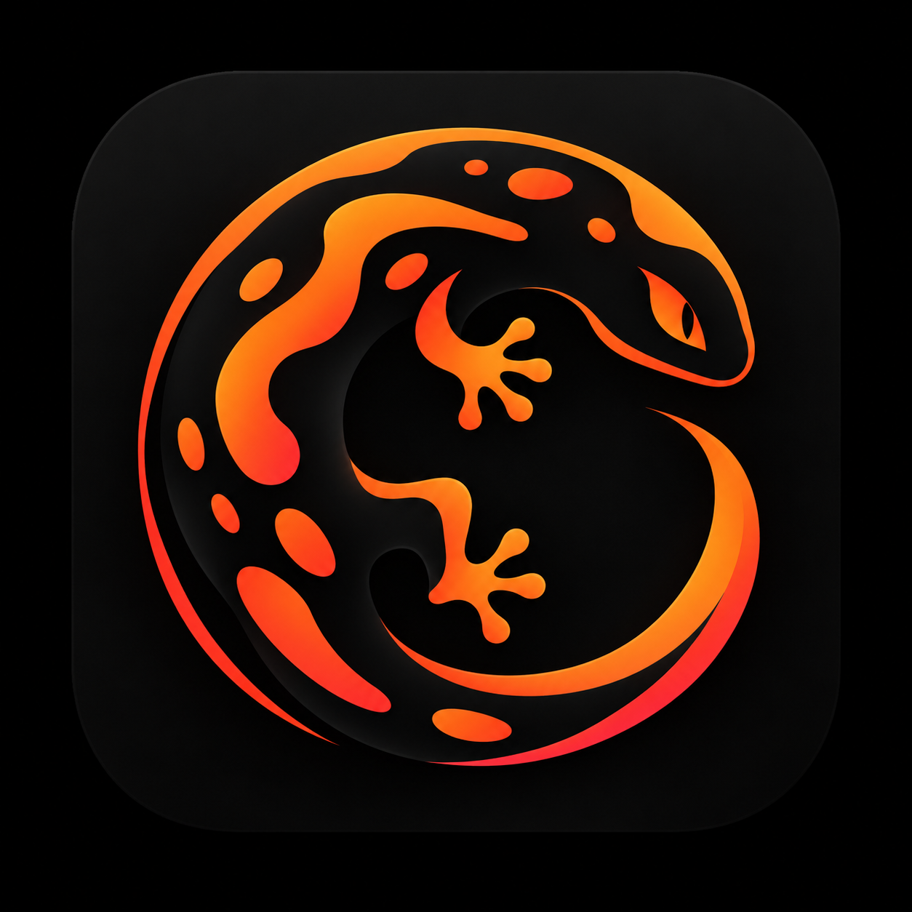

<div align="center">
  
  <h1>Salamander Browser</h1>
  <strong>Open Source Anti-Detect Browser</strong>
</div>
<br>

<p align="center">
  <a style="text-decoration: none;" href="https://github.com/mb-technical-solutions/salamanderbrowser/releases/latest" target="_blank">
  </a>
  <a style="text-decoration: none;" href="https://github.com/mb-technical-solutions/salamanderbrowser/issues" target="_blank">
    
  </a>
  <a style="text-decoration: none;" href="https://github.com/mb-technical-solutions/salamanderbrowser/blob/main/LICENSE" target="_blank">
    
  </a>
  <a style="text-decoration: none;" href="https://github.com/mb-technical-solutions/salamanderbrowser/network/members" target="_blank">
    
  </a>
</p>

## Features

- Unlimited browser profiles: each fully isolated with its own fingerprint, cookies, extensions, and data
- Anti-detect Firefox engine: powered by [Camoufox](https://github.com/daijro/camoufox), a privacy-focused Firefox fork whose fingerprint spoofing is not detected by Cloudflare, reCaptcha v3, or other browser fingerprinting and anti-bot services
- DNS AdBlocker: block ads, trackers, and other unwanted content with per-profile DNS blocking
- Proxy support: HTTP, HTTPS, SOCKS4, SOCKS5 per profile, with dynamic proxy URLs
- VPN support: WireGuard configs per profile
- Profile groups: organize profiles and apply bulk settings
- Import profiles: migrate from Chrome, Edge, Brave, or other Chromium browsers
- Cookie & extension management: import/export cookies, manage extensions per profile
- Default browser: set Salamander as your default browser and choose which profile opens each link
- Zero telemetry: no tracking or device fingerprinting

## Install

<!-- install-links-start -->
### macOS

| | Apple Silicon | Intel |
|---|---|---|
| **DMG** | [Download](https://github.com/mb-technical-solutions/salamanderbrowser/releases/download/v0.30.0/Salamander_0.30.0_aarch64.dmg) | [Download](https://github.com/mb-technical-solutions/salamanderbrowser/releases/download/v0.30.0/Salamander_0.30.0_x64.dmg) |

### Windows

[Download Windows Installer (x64)](https://github.com/mb-technical-solutions/salamanderbrowser/releases/download/v0.30.0/Salamander_0.30.0_x64-setup.exe) · [Portable (x64)](https://github.com/mb-technical-solutions/salamanderbrowser/releases/download/v0.30.0/Salamander_0.30.0_x64-portable.zip)

### Linux

| Format | x86_64 | ARM64 |
|---|---|---|
| **deb** | [Download](https://github.com/mb-technical-solutions/salamanderbrowser/releases/download/v0.30.0/Salamander_0.30.0_amd64.deb) | [Download](https://github.com/mb-technical-solutions/salamanderbrowser/releases/download/v0.30.0/Salamander_0.30.0_arm64.deb) |
| **rpm** | [Download](https://github.com/mb-technical-solutions/salamanderbrowser/releases/download/v0.30.0/Salamander-0.30.0-1.x86_64.rpm) | [Download](https://github.com/mb-technical-solutions/salamanderbrowser/releases/download/v0.30.0/Salamander-0.30.0-1.aarch64.rpm) |
| **AppImage** | [Download](https://github.com/mb-technical-solutions/salamanderbrowser/releases/download/v0.30.0/Salamander_0.30.0_amd64.AppImage) | [Download](https://github.com/mb-technical-solutions/salamanderbrowser/releases/download/v0.30.0/Salamander_0.30.0_aarch64.AppImage) |
<!-- install-links-end -->

<details>
<summary>Troubleshooting AppImage</summary>

If the AppImage segfaults on launch, install libfuse2 (`sudo apt install libfuse2` / `yay -S libfuse2` / `sudo dnf install fuse-libs`), or bypass FUSE entirely:

```bash
APPIMAGE_EXTRACT_AND_RUN=1 ./Salamander_x.x.x_amd64.AppImage
```

If that gives an EGL display error, add `WEBKIT_DISABLE_DMABUF_RENDERER=1` or `GDK_BACKEND=x11` to the command above. If issues persist, the .deb and .rpm packages are more reliable.

</details>

### Nix

```bash
nix run github:mb-technical-solutions/salamanderbrowser#release-start
```

## Contributing

Salamander Browser is built by the people who use it, and plenty of the most useful help involves no code at all.

- Tell other people about Salamander. Word of mouth is how most users find the project, so talking about it is a real contribution.
- Report bugs and request features in [GitHub Issues](https://github.com/mb-technical-solutions/salamanderbrowser/issues).
- Answer questions in [GitHub Discussions](https://github.com/mb-technical-solutions/salamanderbrowser/discussions).
- Fix and improve translations in `src/i18n/locales`.
- Write code. Start with [CONTRIBUTING.md](CONTRIBUTING.md).
- Star the repo so more people see it.

## Star History

<a href="https://gitdebt.com/mb-technical-solutions/salamanderbrowser?ref=readme">
  <picture>
    <source media="(prefers-color-scheme: dark)" srcset="https://api.gitdebt.com/api/repos/mb-technical-solutions/salamanderbrowser/chart.svg?theme=dark&animate=1" />
    
  </picture>
</a>

## Contributors

<a href="https://gitdebt.com/mb-technical-solutions/salamanderbrowser?ref=readme">
  <picture>
    <source media="(prefers-color-scheme: dark)" srcset="https://api.gitdebt.com/api/repos/mb-technical-solutions/salamanderbrowser/stats/contributors.svg?theme=dark&animate=1" />
    
  </picture>
</a>

## Contact

For security vulnerability reports, please use [GitHub Security Advisories](https://github.com/mb-technical-solutions/salamanderbrowser/security/advisories/new) (see [SECURITY.md](SECURITY.md)). For everything else, use [GitHub Issues](https://github.com/mb-technical-solutions/salamanderbrowser/issues) or [Discussions](https://github.com/mb-technical-solutions/salamanderbrowser/discussions).

## License

This project is licensed under the AGPL-3.0 License. See the [LICENSE](LICENSE) file for details.
